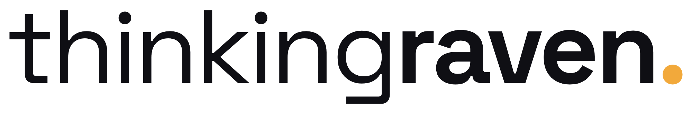

<p align="center">
  
</p>

<p align="center"><strong>Thinking Raven brand kit</strong><br>
Logos, colours, typography and ready-to-use exports.<br>
<a href="https://thinkingraven.github.io/brand/">Brand guidelines site</a> ·
<a href="thinkingraven-brand-kit.zip">Download everything (zip)</a> ·
<a href="AGENTS.md">Rules for AI agents</a></p>

---

## Quick start

| I need… | Use |
|---|---|
| The logo for a website | `logos/final/thinkingraven-wordmark-ink.svg` (light backgrounds) · `…-bone.svg` (dark) |
| A favicon | `exports/favicon/` (`favicon.ico`, `favicon.svg`, `apple-touch-icon.png`) |
| A social profile picture | `exports/social/x-avatar-400.png` (works for X, LinkedIn, GitHub, Patreon) |
| A banner | `exports/social/x-header-1500x500.png` · `linkedin-cover-1128x191.png` · `youtube-banner-2560x1440.png` |
| A link preview image | `exports/social/og-image-1200x630.png` |
| An email signature | `exports/wordmark/email-signature-600.png` (display at 300 px) |
| The app icon | `exports/app/thinky-app-icon-1024.png` |
| Colours or fonts in code | `tokens/tokens.css` · `tokens/tokens.json` |

## Colours

| | Name | Hex | Use |
|---|---|---|---|
| ⬛ | Raven ink | `#0F0F14` | Text on light, dark backgrounds |
| ⬜ | Bone | `#F3EFE6` | Text on dark, light backgrounds |
| 🟧 | Thought amber | `#F2A93B` | Accent only. Never text on light backgrounds. |

**Font:** [Space Grotesk](https://fonts.google.com/specimen/Space+Grotesk) (SIL Open Font Licence, included in `fonts/`).

## The rules in one line

Use the files in this repo as they are: don't redraw, retype, stretch, recolour or add effects to the logo. Ink logo on light backgrounds, bone logo on dark. The full guide is on the [brand site](https://thinkingraven.github.io/brand/).

## For AI agents

Start with [`AGENTS.md`](AGENTS.md). A machine-readable index is at [`llms.txt`](llms.txt).

## Repo layout

```
index.html     brand guidelines site (GitHub Pages)
AGENTS.md      rules for AI agents  ·  llms.txt  machine-readable index
tokens/        design tokens (JSON + CSS)
logos/final/   master SVGs (source of truth)
exports/       PNG / ICO files for every platform
fonts/         Space Grotesk + licence
tools/         scripts that regenerate logos and exports
archive/       round-1 logo exploration
```

## Contact

hello@thinkingraven.com · [x.com/thinkingravenai](https://x.com/thinkingravenai) · [thinkingraven.com](https://thinkingraven.com)

See [LICENSE.md](LICENSE.md) for usage terms.
